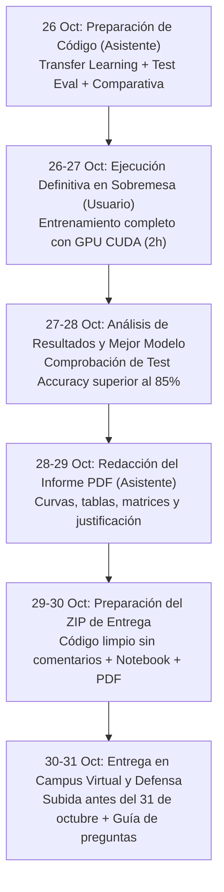

# simpsons-cnn

Clasificador de personajes de Los Simpson con redes neuronales convolucionales en PyTorch.
**Asignatura:** Aprendizaje Automático II (2026-27) — Práctica 1.

---

## Dataset

- **Origen:** [The Simpsons Characters Data](https://www.kaggle.com/datasets/alexattia/the-simpsons-characters-dataset) (Kaggle).
- **Estructura en disco:** Descargado y descomprimido en `data/` (ignorado por Git):
  - `data/simpsons_dataset/`: Carpetas por personaje para entrenamiento y validación.
  - `data/kaggle_simpson_testset/kaggle_simpson_testset/`: Conjunto de test independiente (496 imágenes).

---

## Estructura del Proyecto

```
simpsons-cnn/
├── data/                    # Dataset de imágenes y cachés .npy (ignorado por Git)
├── modelos/                 # Checkpoints de pesos .pth de cada configuración
├── resultados/              # Gráficas, matrices de confusión y CSVs de resultados
├── informe/                 # Informe final en PDF y scripts generadores
├── simpsons_cnn.ipynb       # Cuaderno principal interactivo
├── requirements.txt         # Dependencias Python
└── README.md                # Documentación y hoja de ruta
```

---

## Instalación

```bash
pip install -r requirements.txt
```

> [!TIP]
> Para usar GPU NVIDIA en el sobremesa, verificar la instalación de PyTorch con soporte CUDA:
> ```bash
> python -c "import torch; print('CUDA disponible:', torch.cuda.is_available(), '| Dispositivo:', torch.cuda.get_device_name(0) if torch.cuda.is_available() else 'CPU')"
> ```

---

## Línea de Tiempo y Hoja de Ruta para la Entrega

Fecha límite de entrega: **31 de octubre de 2026**.



### Cronograma de Trabajo

| Fechas | Fase | Hitos Clave | Responsable |
| :--- | :--- | :--- | :--- |
| **26 Octubre** | **Fase 1: Preparación del Código** | Programar celda Transfer Learning, celda de comparativa global y celda de evaluación en test en `simpsons_cnn.ipynb`. | **Asistente** prepara código, **Usuario** revisa. |
| **26 - 27 Octubre** | **Fase 2: Ejecución en Sobremesa** | Llegar a casa, encender PC de sobremesa, desactivar `MODO_PRUEBA`, lanzar ejecución completa sobre GPU NVIDIA (~2 horas). | **Usuario** ejecuta, **Asistente** asiste en el commit. |
| **27 - 28 Octubre** | **Fase 3: Verificación de Resultados** | Comprobar que el mejor modelo supera el 85% de acierto en el test set (496 imágenes) y que se generaron las gráficas. | **Conjunto**. |
| **28 - 29 Octubre** | **Fase 4: Redacción del Informe** | Compilar informe en PDF con tablas de experimentos, curvas train/val, matrices de confusión y justificación técnica. | **Asistente** redacta y maqueta. |
| **29 - 30 Octubre** | **Fase 5: Empaquetado y Código Limpio** | Generar versión de código fuente sin comentarios (requisito estricto del enunciado) y montar el ZIP final. | **Asistente** prepara, **Usuario** verifica. |
| **31 Octubre** | **Fase 6: Entrega y Preparación Defensa** | Subida a Campus Virtual antes del cierre y repaso de la guía de preguntas frecuentes para la defensa con el profesor. | **Usuario** entrega, **Asistente** aporta guía. |

---

## Detalle de Pasos (Plan "Lo Que Falta")

### Paso 1: Transfer Learning (Opcional para máxima nota)
- **Qué se hace:** Añadir a `simpsons_cnn.ipynb` una sección con una red convolucional preentrenada (por ejemplo, **ResNet18** preentrenada en ImageNet) adaptando su capa final (`fc`) a las 10 clases de personajes. Se congela el extractor de características (*feature extractor*) o se hace *fine-tuning* con un learning rate bajo (`1e-4`).
- **Rol:** Asistente programa el código modular; Usuario ejecuta en el sobremesa.
- **Resultado esperado:** Modelo `C11_resnet18_transfer` guardado en `modelos/` y sus curvas en `resultados/`.

### Paso 2: Comparativa Final de Todos los Modelos
- **Qué se hace:** Generar una tabla resumen global (`pd.DataFrame`) que integre todas las familias de modelos:
  1. Modelos manuales de arquitectura propia (C1 a C7).
  2. Modelos con Data Augmentation (C8 y C9).
  3. Modelo optimizado por Optuna (C10).
  4. Modelo con Transfer Learning (C11).
  Identificar automáticamente el **mejor modelo global según la menor pérdida / mayor precisión de validación**.
- **Rol:** Asistente programa la consolidación; Usuario ejecuta.
- **Resultado esperado:** Gráfica comparativa global de barras (`comparativa_final.png`) y selección del modelo ganador.

### Paso 3: Evaluación Única y Definitiva en el Conjunto de Test
- **Qué se hace:** Siguiendo la metodología estricta de clase, cargar los pesos del modelo seleccionado y pasarle **las 496 imágenes de test una sola vez**:
  - Exactitud global en Test (`accuracy_score`).
  - Informe detallado por personaje (`classification_report` con precision, recall y F1-score).
  - Matriz de confusión final en test guardada en `resultados/matriz_confusion_test.png`.
  - Comprobar que la tasa de acierto supera el **85%** esperado por el enunciado.
- **Rol:** Asistente programa la celda de evaluación; Usuario ejecuta en sobremesa.
- **Resultado esperado:** Métricas definitivas no sesgadas y matriz de confusión de test lista para el informe.

### Paso 4: Ejecución Definitiva en el Sobremesa
- **Qué se hace:** Ejecutar el cuaderno completo de principio a fin (`Kernel -> Restart & Run All`) con aceleración CUDA activada (`MODO_PRUEBA = False`, imágenes a $128 \times 128$ px y dataset completo). Duración estimada: ~1.5 a 2 horas. Guardar el `.ipynb` con todas las salidas gráficas visibles y hacer commit en el repositorio Git.
- **Rol:** Usuario ejecuta en su PC; Asistente guía la verificación y confección del commit.
- **Resultado esperado:** Cuaderno `simpsons_cnn.ipynb` completamente ejecutado y artefactos en `resultados/` y `modelos/`.

### Paso 5: Informe en PDF
- **Qué se hace:** Elaborar la memoria escrita requerida por el enunciado:
  - Justificación de la arquitectura base y mecanismo de parada temprana.
  - Tabla completa del proceso de búsqueda manual de hiperparámetros.
  - Análisis de curvas de aprendizaje (diagnóstico de subajuste vs sobreajuste).
  - Impacto del Data Augmentation y búsqueda con Optuna.
  - Rendimiento del Transfer Learning.
  - Resultados finales en el conjunto de test con análisis de la matriz de confusión (parejas de personajes más confusos).
- **Rol:** Asistente redacta y genera el documento PDF.
- **Resultado esperado:** Documento PDF en `informe/` listo para imprimir o adjuntar.

### Paso 6: Generación del ZIP de Entrega
- **Qué se hace:** 
  1. Generar la versión del código sin comentarios solicitada en el enunciado (*"código sin comentarios"*).
  2. Empaquetar el archivo comprimido final conteniendo:
     - Cuaderno `.ipynb` ejecutado con todas las salidas.
     - Script Python limpio sin comentarios.
     - Informe final en PDF.
  3. Verificar que el ZIP cumple todas las especificaciones antes de la fecha límite (31 de octubre).
- **Rol:** Asistente prepara los ficheros y el script de empaquetado; Usuario realiza la entrega en el Campus Virtual.
- **Resultado esperado:** Archivo `entrega_practica1_simpsons.zip`.

### Paso 7: Guía para la Defensa
- **Qué se hace:** Crear un documento de preparación para la defensa oral del trabajo ante el profesor (Javier Lorenzo Navarro), cubriendo:
  - Justificación de decisiones (por qué Adam, por qué CrossEntropyLoss, tamaño de kernel 3x3 vs 5x5).
  - Cómo actúa la parada temprana guardando el `state_dict`.
  - Explicación de cómo el Data Augmentation reduce el sobreajuste.
  - Diferencias entre extracción de características y fine-tuning en Transfer Learning.
  - Posibles preguntas trampa y cómo responderlas con solidez teórica y práctica.
- **Rol:** Asistente redacta la guía completa de preguntas y respuestas.
- **Resultado esperado:** Documento de estudio rápido para sacar la máxima nota en la defensa.

---

## Checklist Rápido para cuando llegues a casa (PC de Sobremesa)

1. [ ] Abrir el proyecto en VS Code en el PC de sobremesa.
2. [ ] Asegurarse de tener el entorno virtual activo con PyTorch y CUDA (`nvidia-smi` operativo).
3. [ ] Comprobar que en la celda 3 esté activo:
   ```python
   device = 'cuda' if torch.cuda.is_available() else 'cpu'
   MODO_PRUEBA = False  # <-- Modo completo para entrenar con todo el dataset
   ```
4. [ ] Ejecutar el notebook completo con **Run All**.
5. [ ] Avisarme con los resultados obtenidos para proceder con la generación del informe en PDF y la preparación del ZIP.
